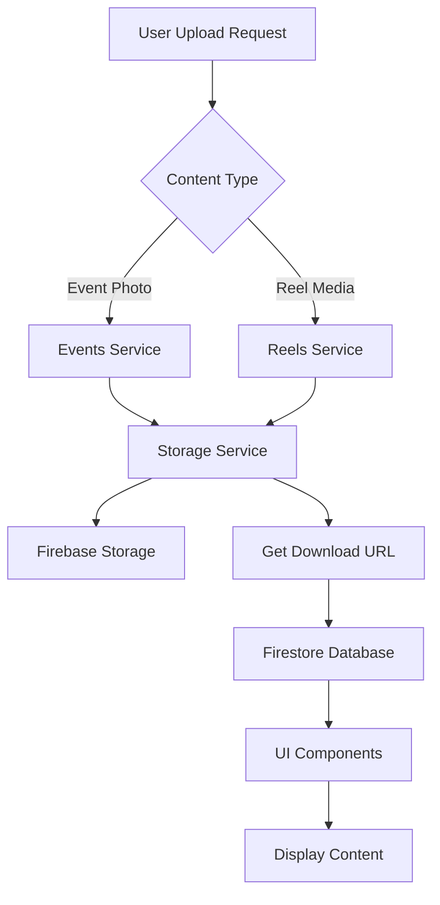

# Firebase Storage Implementation Plan

## Overview

This document outlines the complete implementation plan for integrating Firebase Storage with the ADG application, supporting:

- Event photo uploads to Firebase Storage
- Multi-media Reels (photos AND videos mixed in single posts)
- Carousel navigation for multi-media content
- Complete CRUD operations with Firebase services
- Security rules for Storage and Firestore

## Architecture Overview



## File Structure

```
src/
├── services/
│   ├── storageService.ts      # Firebase Storage operations
│   ├── eventService.ts         # Event CRUD operations
│   └── reelService.ts          # Reel CRUD operations
├── types/
│   └── index.ts                # Type definitions
└── components/
    ├── EventsPage/
    │   └── Events.tsx          # Updated with Firebase integration
    └── ReelsPage/
        └── Reels.tsx           # Updated with multi-media carousel
```

## Data Models

### Event Interface

```typescript
interface Event {
  id: string;
  name: string;
  type: "g-body" | "major";
  date: string; // ISO date string
  startTime: string; // HH:MM format
  endTime: string; // HH:MM format
  description: string;
  link?: string;
  photoUrl: string; // Firebase Storage URL
  uploadedBy: string; // User UID
  uploadedAt: Timestamp;
}
```

### Reel Interface (Multi-Media)

```typescript
interface MediaItem {
  id: string;
  type: "photo" | "video";
  url: string; // Firebase Storage URL
  thumbnailUrl?: string; // For videos
  order: number; // Display order
}

interface Reel {
  id: string;
  media: MediaItem[]; // Array of photos/videos
  caption: string;
  uploadedBy: string; // User UID
  uploaderName: string;
  likes: number;
  likedBy: string[];
  comments: Comment[];
  views: number;
  createdAt: Timestamp;
}
```

## Firebase Storage Structure

```
storage/
├── events/
│   └── {userId}/
│       └── {eventId}/
│           └── photo.{ext}
└── reels/
    └── {userId}/
        └── {reelId}/
            └── media/
                ├── 0.{ext}
                ├── 1.{ext}
                ├── 2.{ext}
                └── thumbnails/
                    ├── 0.jpg
                    └── 1.jpg
```

## Service Implementations

### 1. Storage Service (`storageService.ts`)

```typescript
import {
  getStorage,
  ref,
  uploadBytes,
  getDownloadURL,
  deleteObject,
} from "firebase/storage";
import { app } from "../firebase";

const storage = getStorage(app);

export interface UploadProgress {
  progress: number;
  status: "uploading" | "complete" | "error";
}

/**
 * Upload a file to Firebase Storage
 */
export async function uploadFile(
  file: File,
  path: string,
  onProgress?: (progress: UploadProgress) => void
): Promise<string> {
  try {
    const storageRef = ref(storage, path);

    // Upload file
    const snapshot = await uploadBytes(storageRef, file);

    // Get download URL
    const downloadURL = await getDownloadURL(snapshot.ref);

    if (onProgress) {
      onProgress({ progress: 100, status: "complete" });
    }

    return downloadURL;
  } catch (error) {
    if (onProgress) {
      onProgress({ progress: 0, status: "error" });
    }
    throw error;
  }
}

/**
 * Delete a file from Firebase Storage
 */
export async function deleteFile(path: string): Promise<void> {
  const storageRef = ref(storage, path);
  await deleteObject(storageRef);
}

/**
 * Upload multiple files
 */
export async function uploadMultipleFiles(
  files: File[],
  basePath: string,
  onProgress?: (index: number, progress: UploadProgress) => void
): Promise<string[]> {
  const uploadPromises = files.map((file, index) => {
    const extension = file.name.split(".").pop();
    const path = `${basePath}/${index}.${extension}`;

    return uploadFile(file, path, (progress) => {
      if (onProgress) {
        onProgress(index, progress);
      }
    });
  });

  return Promise.all(uploadPromises);
}
```

### 2. Event Service (`eventService.ts`)

```typescript
import { db } from "../firebase";
import {
  collection,
  doc,
  getDoc,
  getDocs,
  setDoc,
  updateDoc,
  deleteDoc,
  Timestamp,
  query,
  orderBy,
} from "firebase/firestore";
import { uploadFile, deleteFile } from "./storageService";
import { Event } from "../types";

const EVENTS_COLLECTION = "events";

/**
 * Upload event photo to Firebase Storage
 */
export async function uploadEventPhoto(
  userId: string,
  eventId: string,
  photoFile: File
): Promise<string> {
  const extension = photoFile.name.split(".").pop();
  const path = `events/${userId}/${eventId}/photo.${extension}`;
  return await uploadFile(photoFile, path);
}

/**
 * Create a new event
 */
export async function createEvent(
  eventData: Omit<Event, "id" | "photoUrl" | "uploadedAt">,
  photoFile: File,
  userId: string
): Promise<string> {
  const eventId = doc(collection(db, EVENTS_COLLECTION)).id;

  // Upload photo
  const photoUrl = await uploadEventPhoto(userId, eventId, photoFile);

  // Create event document
  const event: Event = {
    ...eventData,
    id: eventId,
    photoUrl,
    uploadedBy: userId,
    uploadedAt: Timestamp.now(),
  };

  await setDoc(doc(db, EVENTS_COLLECTION, eventId), event);
  return eventId;
}

/**
 * Get event by ID
 */
export async function getEvent(eventId: string): Promise<Event | null> {
  const docSnap = await getDoc(doc(db, EVENTS_COLLECTION, eventId));
  return docSnap.exists() ? (docSnap.data() as Event) : null;
}

/**
 * Get all events
 */
export async function getAllEvents(): Promise<Event[]> {
  const q = query(collection(db, EVENTS_COLLECTION), orderBy("date", "desc"));
  const querySnapshot = await getDocs(q);
  return querySnapshot.docs.map((doc) => doc.data() as Event);
}

/**
 * Update event
 */
export async function updateEvent(
  eventId: string,
  updates: Partial<Event>,
  newPhotoFile?: File,
  userId?: string
): Promise<void> {
  if (newPhotoFile && userId) {
    const photoUrl = await uploadEventPhoto(userId, eventId, newPhotoFile);
    updates.photoUrl = photoUrl;
  }

  await updateDoc(doc(db, EVENTS_COLLECTION, eventId), updates);
}

/**
 * Delete event
 */
export async function deleteEvent(
  eventId: string,
  userId: string
): Promise<void> {
  // Delete photo from storage
  try {
    await deleteFile(`events/${userId}/${eventId}/photo.jpg`);
  } catch (error) {
    console.log("Photo not found or already deleted");
  }

  // Delete document
  await deleteDoc(doc(db, EVENTS_COLLECTION, eventId));
}

// Getter functions as requested
export function getEventName(event: Event): string {
  return event.name;
}

export function getEventPhoto(event: Event): string {
  return event.photoUrl;
}

export function getEventType(event: Event): "g-body" | "major" {
  return event.type;
}

export function getEventDate(event: Event): string {
  return event.date;
}

export function getStartTime(event: Event): string {
  return event.startTime;
}

export function getEndTime(event: Event): string {
  return event.endTime;
}

export function getDescription(event: Event): string {
  return event.description;
}

export function getEventLink(event: Event): string | undefined {
  return event.link;
}
```

### 3. Reel Service (`reelService.ts`)

```typescript
import { db } from "../firebase";
import {
  collection,
  doc,
  getDoc,
  getDocs,
  setDoc,
  updateDoc,
  deleteDoc,
  Timestamp,
  query,
  orderBy,
  increment,
} from "firebase/firestore";
import { uploadMultipleFiles, deleteFile } from "./storageService";
import { Reel, MediaItem } from "../types";

const REELS_COLLECTION = "reels";

/**
 * Upload media files for a reel
 */
export async function uploadReelMedia(
  userId: string,
  reelId: string,
  mediaFiles: File[]
): Promise<MediaItem[]> {
  const basePath = `reels/${userId}/${reelId}/media`;

  const urls = await uploadMultipleFiles(mediaFiles, basePath);

  return mediaFiles.map(
    (file, index) =>
      ({
        id: `${reelId}_${index}`,
        type: file.type.startsWith("video") ? "video" : "photo",
        url: urls[index],
        order: index,
      } as MediaItem)
  );
}

/**
 * Create a new reel
 */
export async function createReel(
  caption: string,
  mediaFiles: File[],
  userId: string,
  userName: string
): Promise<string> {
  const reelId = doc(collection(db, REELS_COLLECTION)).id;

  // Upload media
  const media = await uploadReelMedia(userId, reelId, mediaFiles);

  // Create reel document
  const reel: Reel = {
    id: reelId,
    media,
    caption,
    uploadedBy: userId,
    uploaderName: userName,
    likes: 0,
    likedBy: [],
    comments: [],
    views: 0,
    createdAt: Timestamp.now(),
  };

  await setDoc(doc(db, REELS_COLLECTION, reelId), reel);
  return reelId;
}

/**
 * Get reel by ID
 */
export async function getReel(reelId: string): Promise<Reel | null> {
  const docSnap = await getDoc(doc(db, REELS_COLLECTION, reelId));
  return docSnap.exists() ? (docSnap.data() as Reel) : null;
}

/**
 * Get all reels
 */
export async function getAllReels(): Promise<Reel[]> {
  const q = query(
    collection(db, REELS_COLLECTION),
    orderBy("createdAt", "desc")
  );
  const querySnapshot = await getDocs(q);
  return querySnapshot.docs.map((doc) => doc.data() as Reel);
}

/**
 * Like/unlike a reel
 */
export async function toggleReelLike(
  reelId: string,
  userId: string
): Promise<void> {
  const reelRef = doc(db, REELS_COLLECTION, reelId);
  const reelSnap = await getDoc(reelRef);

  if (!reelSnap.exists()) return;

  const reel = reelSnap.data() as Reel;
  const hasLiked = reel.likedBy.includes(userId);

  await updateDoc(reelRef, {
    likes: hasLiked ? increment(-1) : increment(1),
    likedBy: hasLiked
      ? reel.likedBy.filter((id) => id !== userId)
      : [...reel.likedBy, userId],
  });
}

/**
 * Delete reel
 */
export async function deleteReel(
  reelId: string,
  userId: string
): Promise<void> {
  const reel = await getReel(reelId);
  if (!reel) return;

  // Delete all media files
  for (let i = 0; i < reel.media.length; i++) {
    try {
      await deleteFile(`reels/${userId}/${reelId}/media/${i}`);
    } catch (error) {
      console.log(`Media ${i} not found or already deleted`);
    }
  }

  // Delete document
  await deleteDoc(doc(db, REELS_COLLECTION, reelId));
}

/**
 * Get video URL for a reel (backward compatibility)
 */
export async function getVideo(reelId: string): Promise<string | null> {
  const reel = await getReel(reelId);
  if (!reel) return null;

  const videoItem = reel.media.find((item) => item.type === "video");
  return videoItem?.url || null;
}

/**
 * Get photo URL for a reel (backward compatibility)
 */
export async function getPhoto(reelId: string): Promise<string | null> {
  const reel = await getReel(reelId);
  if (!reel) return null;

  const photoItem = reel.media.find((item) => item.type === "photo");
  return photoItem?.url || null;
}
```

## UI Component Updates

### Reels.tsx - Multi-Media Carousel

Key features to implement:

1. Multiple file selection (photos and videos)
2. Horizontal carousel with swipe/navigation
3. Media type indicator (photo/video icon)
4. Progress dots showing current position
5. Touch gestures for mobile

```typescript
// Key state additions
const [selectedFiles, setSelectedFiles] = useState<File[]>([]);
const [currentMediaIndex, setCurrentMediaIndex] = useState(0);
const [uploadProgress, setUploadProgress] = useState<number[]>([]);

// Carousel navigation
const handleNextMedia = () => {
  if (currentMediaIndex < currentReel.media.length - 1) {
    setCurrentMediaIndex(currentMediaIndex + 1);
  }
};

const handlePrevMedia = () => {
  if (currentMediaIndex > 0) {
    setCurrentMediaIndex(currentMediaIndex - 1);
  }
};
```

## Firebase Security Rules

### Firestore Security Rules

```javascript
rules_version = '2';
service cloud.firestore {
  match /databases/{database}/documents {

    // Helper functions
    function isAuthenticated() {
      return request.auth != null;
    }

    function isOwner(userId) {
      return isAuthenticated() && request.auth.uid == userId;
    }

    function isAdmin() {
      return isAuthenticated()
        && exists(/databases/$(database)/documents/users/$(request.auth.uid))
        && get(/databases/$(database)/documents/users/$(request.auth.uid)).data.isAdmin == true;
    }

    // Users Collection
    match /users/{userId} {
      allow read: if isOwner(userId);
      allow create: if isOwner(userId)
        && request.resource.data.keys().hasAll(['email', 'name', 'birthday', 'school', 'createdAt']);
      allow update: if isOwner(userId)
        && request.resource.data.uid == resource.data.uid
        && request.resource.data.email == resource.data.email;
      allow delete: if false;
    }

    // Events Collection
    match /events/{eventId} {
      allow read: if isAuthenticated();
      allow create: if isAdmin()
        && request.resource.data.keys().hasAll(['name', 'type', 'date', 'startTime', 'endTime', 'description', 'photoUrl', 'uploadedBy', 'uploadedAt'])
        && request.resource.data.uploadedBy == request.auth.uid;
      allow update: if isAdmin();
      allow delete: if isAdmin();
    }

    // Reels Collection
    match /reels/{reelId} {
      allow read: if isAuthenticated();
      allow create: if isAuthenticated()
        && request.resource.data.uploadedBy == request.auth.uid
        && request.resource.data.keys().hasAll(['media', 'caption', 'uploadedBy', 'uploaderName', 'likes', 'likedBy', 'comments', 'views', 'createdAt'])
        && request.resource.data.media is list;
      allow update: if isOwner(resource.data.uploadedBy) || isAdmin();
      allow delete: if isOwner(resource.data.uploadedBy) || isAdmin();
    }
  }
}
```

### Firebase Storage Security Rules

```javascript
rules_version = '2';
service firebase.storage {
  match /b/{bucket}/o {

    // Helper functions
    function isAuthenticated() {
      return request.auth != null;
    }

    function isOwner(userId) {
      return request.auth.uid == userId;
    }

    function isAdmin() {
      return firestore.get(/databases/(default)/documents/users/$(request.auth.uid)).data.isAdmin == true;
    }

    function isImage() {
      return request.resource.contentType.matches('image/.*');
    }

    function isVideo() {
      return request.resource.contentType.matches('video/.*');
    }

    function isImageOrVideo() {
      return isImage() || isVideo();
    }

    function isValidSize() {
      // Max 50MB for videos, 10MB for images
      return (isVideo() && request.resource.size < 50 * 1024 * 1024)
          || (isImage() && request.resource.size < 10 * 1024 * 1024);
    }

    // Events Storage
    match /events/{userId}/{eventId}/{fileName} {
      allow read: if isAuthenticated();
      allow write: if isAdmin()
        && isOwner(userId)
        && isImage()
        && isValidSize();
      allow delete: if isAdmin() && isOwner(userId);
    }

    // Reels Storage
    match /reels/{userId}/{reelId}/media/{mediaFile} {
      allow read: if isAuthenticated();
      allow write: if isAuthenticated()
        && isOwner(userId)
        && isImageOrVideo()
        && isValidSize();
      allow delete: if isOwner(userId) || isAdmin();
    }

    // Reel Thumbnails
    match /reels/{userId}/{reelId}/media/thumbnails/{thumbFile} {
      allow read: if isAuthenticated();
      allow write: if isOwner(userId);
      allow delete: if isOwner(userId) || isAdmin();
    }
  }
}
```

## Implementation Steps

1. **Phase 1: Setup Services**

   - Create `storageService.ts`
   - Create `eventService.ts`
   - Create `reelService.ts`
   - Add type definitions

2. **Phase 2: Update Components**

   - Integrate Firebase Storage in [`Events.tsx`](afrdevgrp-react/src/components/EventsPage/Events.tsx)
   - Add multi-file upload to [`Reels.tsx`](afrdevgrp-react/src/components/ReelsPage/Reels.tsx)
   - Implement carousel navigation

3. **Phase 3: Security**

   - Deploy Firestore security rules
   - Deploy Storage security rules
   - Test access controls

4. **Phase 4: Testing**
   - Test event photo uploads
   - Test multi-media reel uploads
   - Test carousel navigation
   - Test delete operations

## Progress Tracking

- [ ] Storage service created
- [ ] Event service created
- [ ] Reel service created
- [ ] Events.tsx updated
- [ ] Reels.tsx updated with carousel
- [ ] Security rules deployed
- [ ] Testing completed

## Next Steps

Once this plan is approved, switch to Code mode to begin implementation following this architecture.
